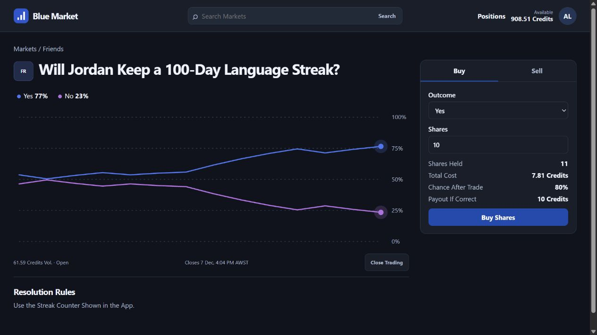

# Blue Market

Host a prediction market for your friends, club, or community. Set up your site, make it your own in Admin, and trade on your own questions with virtual credits.

[Docker](#docker) · [Render](#render) · [Node.js and Pterodactyl](#nodejs-and-pterodactyl)


## Features

* Virtual credit trading
* Yes or no markets and markets with multiple outcomes
* Interactive price charts
* Positions, payouts, and trade history
* Leaderboard and audit log
* Custom name, logo, colors, and currency
* Sign Ups, account roles, and market permissions

## Installation

### Docker

Extract the repository ZIP or clone the repository, then run these commands in its folder:

```sh
docker build -t blue-market .
docker run --name blue-market -p 3000:3000 -v blue-market-data:/data blue-market
```

Open [http://localhost:3000](http://localhost:3000). The volume keeps your markets and accounts when the container is replaced.

### Render

[](https://render.com/deploy?repo=https%3A%2F%2Fgithub.com%2FKalebChristian%2FBlue-Market)

Requires a paid web service with persistent storage.

### Node.js and Pterodactyl

Run `node server.js` with Node.js 24. On Pterodactyl, set `server.js` as the startup file and open the assigned address.

After startup, create your admin account with the setup code from the server logs. See the [deployment guide](docs/deployment.md) for setup, configuration, and backups.

## Screenshots

<p>
  
  
</p>
<p>
  
  
</p>

## Development

```sh
npm run demo
npm test
```

The demo runs locally at [http://localhost:3000](http://localhost:3000) and resets when stopped.

## License

[MIT](LICENSE)
