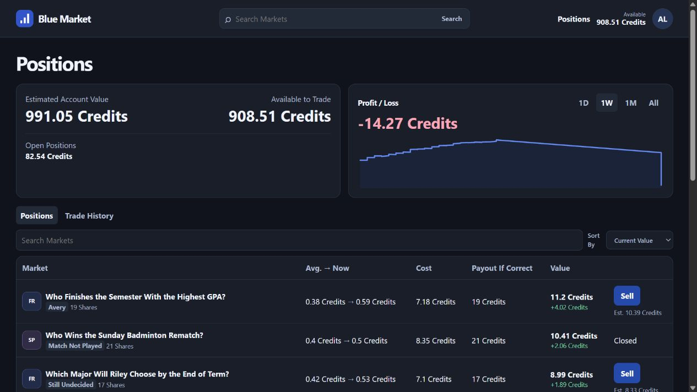
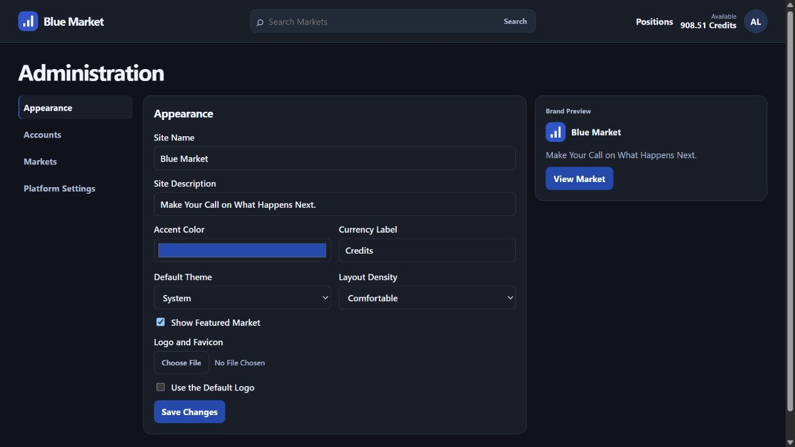

# Blue Market

Host a prediction market for your friends, club, or community. Set up your site, make it your own in Admin, and trade on your own questions with virtual credits.

[](https://render.com/deploy?repo=https%3A%2F%2Fgithub.com%2FKalebChristian%2FBlue-Market)


## Features

* Virtual credit trading
* Yes or no markets and markets with multiple outcomes
* Interactive price charts
* Positions, payouts, and trade history
* Leaderboard and audit log
* Custom name, logo, colors, and currency
* Sign Ups, account roles, and market permissions

## Installation

| Platform | Requirements |
| --- | --- |
| Render | A paid web service with persistent storage |
| Docker | A machine running Docker |
| Node.js or Pterodactyl | Node.js 24 |

See the [deployment guide](docs/deployment.md) for Docker, Render, and Pterodactyl instructions. After startup, open the app and create your admin account using the setup code in the server logs.

## Screenshots

<p>
  
  
</p>
<p>
  
  
</p>

## Development

```sh
npm run demo
npm test
```

The demo runs locally at [http://localhost:3000](http://localhost:3000) and resets when stopped.

## License

[MIT](LICENSE)
