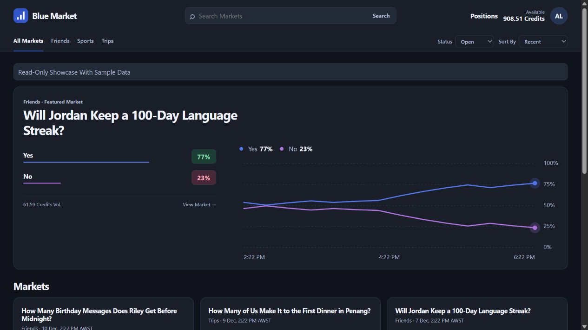
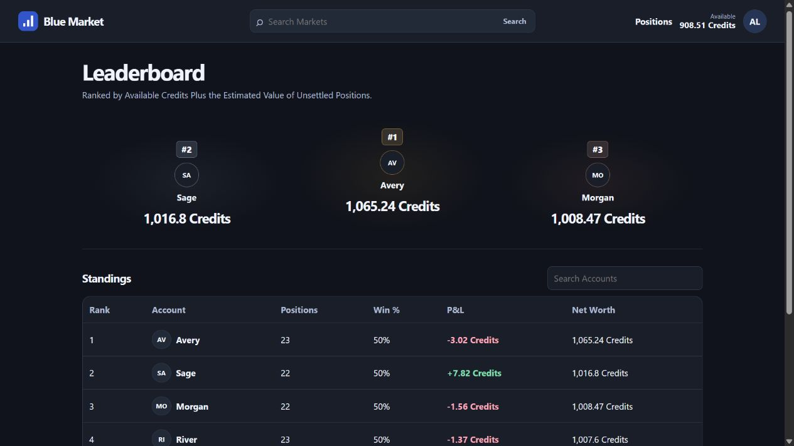

# Blue Market

Blue Market is a self-hosted prediction market for friends, clubs, and communities. Use virtual credits to trade on anything from match results to group plans. Customize the branding, market categories, and access rules in the admin panel.



## Features

- **Markets** — Create binary or multiple-outcome questions, set a trading deadline, and resolve or void markets.
- **Trading** — Buy and sell shares with virtual credits, inspect price history, and track positions and payouts.
- **Administration** — Configure branding and sign-ups, manage account roles and balances, and control who can create and resolve markets.
- **Standings** — Track positions, win percentage, realized P&L, and net worth. Control access to the leaderboard and audit log in Admin.

## Installation

### Docker

Run from the repository directory:

```sh
docker build -t blue-market .
docker run --name blue-market -p 3000:3000 -v blue-market-data:/data blue-market
```

Open [http://localhost:3000](http://localhost:3000). The Docker volume keeps the database between container replacements.

### Node.js

Use **Node.js 24**. The app has no npm dependencies.

```sh
node server.js
```

Open [http://localhost:3000](http://localhost:3000). On Pterodactyl, set the startup file to `server.js` and open the assigned address. Keep the `data/` directory when updating.

### Render

[](https://render.com/deploy?repo=https%3A%2F%2Fgithub.com%2FKalebChristian%2FBlue-Market)

Requires a paid service with persistent storage.

## First run

1. Open the app and create your admin account with the one-time setup code from the server logs.
2. In **Admin**, customize your site and choose whether to open sign-ups or create accounts yourself.
3. Select **Create Market**, add a question and outcomes, and set the closing time and resolution rules.

To try the app with fictional data on your computer, run `npm run demo` and choose **Enter the Demo**. Demo changes are cleared when the process stops.

## Leaderboard



## Configuration

| Variable | Purpose |
| --- | --- |
| `BLUE_DATA` | SQLite data directory. Defaults to `data/`, or `/data` in Docker. |
| `SERVER_PORT` | Listening port. Takes precedence over `PORT`. |
| `PORT` | Listening port when `SERVER_PORT` is unset. Defaults to `3000`. |
| `BLUE_SETUP_CODE` | Optional private first-run code. Otherwise the server generates one. |

Run one instance per database. To back up a running instance, use `node server.js --backup /path/to/backup.sqlite` with the same `BLUE_DATA` as the app. To restore, stop the app and place the backup in a clean data directory as `market.sqlite`.

## Development

Run `npm test` to check first-run setup, trading, settlement, and access controls.

## License

[MIT](LICENSE)
